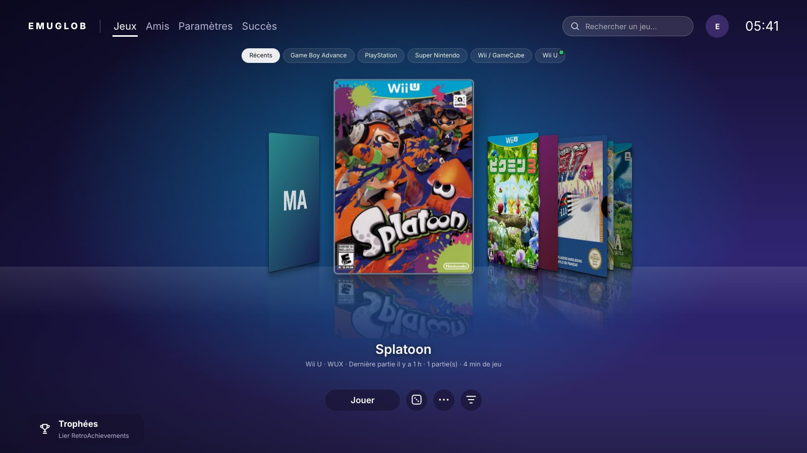
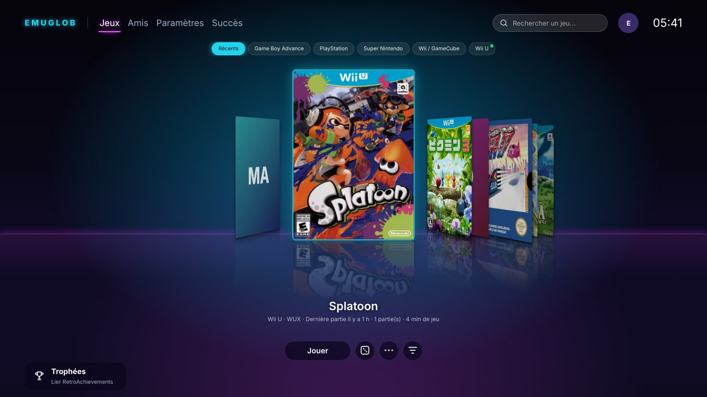
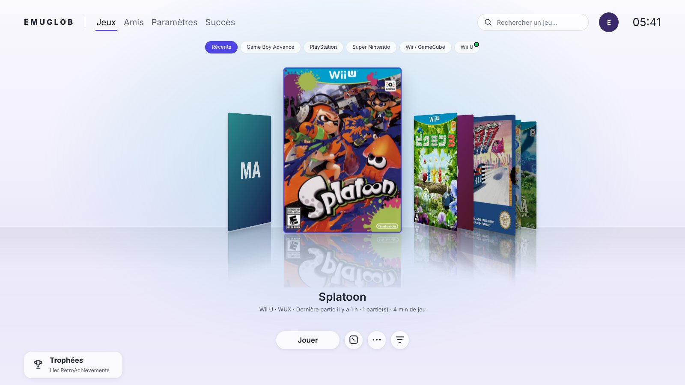

<div align="center">


# EMUGLOB

**Your retro game library, in a single launcher.**

A cover library, your emulators embedded in the window, your RetroAchievements and your saves in one place.

Windows 10 / 11 · 64-bit · English and French

**English** · [Français](README.fr.md)

</div>



## What Emuglob does

### Library
- Three home layouts: **Wheel** (3D cover flow with reflection), **Shelf** and **Showcase**. Mouse, keyboard or gamepad.
- One tab per console, Favorites and Recent, sorting (A→Z, play time, last played, date added) and a "never played" filter.
- Covers found automatically (libretro-thumbnails, GameTDB, PS1/PS2 covers, RetroAchievements), flat and cropped.
- Game page: summary (Wikipedia), year, publisher, genre, screenshots, length, RetroAchievements and your play time.
- Watched folders: new games show up at startup.
- Offline mode: covers, badges and info already seen stay available without internet.

### Playing
- The emulator opens **inside** the Emuglob window, with an in-game bar: emulator volume, quick settings (Dolphin, PCSX2), controls, restart, fullscreen.
- Animated loading screen: the cartridge or disc slides into a matching console.
- Play time, session count and stats in your profile.
- Discord Rich Presence (simple on/off).

### RetroAchievements
- Achievements, progress and details for each game, with your own RA account.
- **Subsets**: pick the set when launching, the patch (.xdelta, .bps, .ips) is applied automatically, on every console.
- Game recognition by hash (cartridges, DS) then by title, accents ignored.
- Achievements with RALibretro, PCSX2, Dolphin and PPSSPP.
- Profile with cards and badges, friends and their activity.

### Emulators
- One-click install and update from their official source: **RALibretro** (and its cores), **PCSX2**, **Cemu**. Version choice under Settings, System.
- Also supported: **Dolphin**, **PPSSPP**, **Azahar** (detected in the `emulators` folder next to Emuglob.exe, or set by path).
- Controls and hotkeys editable from Emuglob (RALibretro, PCSX2, Dolphin, Azahar), with keyboard or gamepad.
- If an emulator is missing (unplugged drive, moved folder), Emuglob says why and offers to locate or reinstall it.

### Saves
- Automatic backups of your saves after each session, shared between emulators when possible (RetroArch, Cemu…).
- "Find my saves": looks for saves already on your PC (emulator folders, next to ROMs…) and imports them without touching the originals.

### Look
- 6 themes: Aurora, Neon, OLED, Phosphor, Light, Pastel. Background color per console, ambient background, custom wallpaper, menu sounds.
- Built for ultra-wide screens too.

| Neon theme | Light theme |
|---|---|
|  |  |

**Game page**


## Consoles

| Emulator | Consoles |
|---|---|
| RALibretro (libretro cores) | NES, SNES, N64, Game Boy / Color / Advance, DS, Mega Drive, Master System, Game Gear, PC Engine, PlayStation, Atari, Neo Geo Pocket, arcade… |
| PCSX2 | PlayStation 2 |
| Dolphin | Wii, GameCube |
| Cemu | Wii U |

Other emulators can be added manually (path and arguments in Settings, Emulators).

## Installation

1. Download the `.zip` from the latest [Release](../../releases/latest).
2. Extract it anywhere (for example `C:\Games\Emuglob`).
3. Run `Emuglob.exe`. A short tutorial walks you through the rest.

**Updates** are done from Emuglob (pop-up at launch, or Settings, Update). Only the Release's `app.asar` file is downloaded, and its SHA-256 hash is checked before it is installed.

> **No games, BIOS or console keys are included.** Only use your own game backups, the BIOS from your own console (PS1, PS2) and keys dumped from your own Wii U (Cemu).

## For developers

```
npm install
npm start          # run from source
npm run build-info # SHA-256 hashes checked at startup (run before building app.asar)
npm run pack       # Windows build in dist/
```

User configuration lives in `%APPDATA%\emuglob-launcher\` (`config.json`, covers, saves, backups, cache).

## License

Emuglob is free software under the [GPL-3.0](LICENSE) license: you can use, modify and redistribute it, as long as you keep the same license and share the source code of your changes.

## Credits

Emuglob does not contain any emulator. The ones it installs are downloaded from their official source and run as separate programs:
[RALibretro](https://github.com/RetroAchievements/RALibretro) (GPL-3.0),
[PCSX2](https://github.com/PCSX2/pcsx2) (GPL-3.0),
[Cemu](https://github.com/cemu-project/Cemu) (MPL-2.0),
[Dolphin](https://dolphin-emu.org) (GPL-2.0+),
RALibretro cores come from the [libretro buildbot](https://buildbot.libretro.com).

Services used: [RetroAchievements](https://retroachievements.org) (achievements, with your own account), [libretro-thumbnails](https://github.com/libretro-thumbnails), [GameTDB](https://www.gametdb.com) and [xlenore](https://github.com/xlenore) (covers), Discord (Rich Presence).

Bundled third-party software: [7-Zip](https://www.7-zip.org) (`tools/7za.exe`, Igor Pavlov, GNU LGPL), used only to extract downloaded emulators, and [xdelta3](https://github.com/jmacd/xdelta-gpl) (GPL-2.0+) for subset patches. See `tools/7za-LICENSE.txt` and `tools/xdelta3-LICENSE.txt`.

Emuglob is not affiliated with any console maker or with any of the projects listed. Console names belong to their owners.
