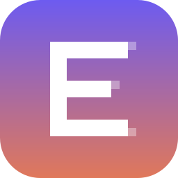

<div align="center">



# EMUGLOB

**Ta bibliothèque de jeux rétro, dans un seul lanceur.**

Une roue de jaquettes, tes émulateurs intégrés dans la fenêtre, tes succès RetroAchievements et tes sauvegardes au même endroit.

Windows 10 / 11 · 64 bits · en français

</div>


## Ce que fait Emuglob

### Bibliothèque
- Roue de jaquettes en 3D avec reflet, à la souris (clic maintenu + glisser), au clavier ou à la manette.
- Onglet par console, Favoris et Récents, tri (nom, temps de jeu, dernier lancement, date d'ajout) et filtre « jamais lancés ».
- Jaquettes trouvées toutes seules (libretro-thumbnails, GameTDB, covers PS1/PS2, RetroAchievements), à plat et recadrées.
- Dossiers surveillés : les nouveaux jeux déposés apparaissent au démarrage.
- Mode hors ligne : jaquettes, badges et infos déjà vus restent disponibles sans internet.

### Jouer
- L'émulateur s'ouvre **dans** la fenêtre d'Emuglob, avec une barre en jeu : volume de l'émulateur, réglages rapides (Dolphin, PCSX2), plein écran.
- Écran de chargement animé : la cartouche ou le disque entre dans une console assortie.
- Temps de jeu, nombre de parties et statistiques dans ton profil.
- Rich Presence Discord (simple on/off).

### Émulateurs
- Installation et mise à jour en un clic depuis leur source officielle : **RALibretro**, **PCSX2**, **Cemu**, **Dolphin**, plus les cores RALibretro.
- Contrôles et raccourcis modifiables depuis Emuglob (RALibretro, PCSX2, Dolphin, Azahar), au clavier ou à la manette.
- Si un émulateur a disparu (disque débranché, dossier déplacé), Emuglob dit pourquoi et propose de le retrouver ou de le réinstaller.

### Sauvegardes
- Copies automatiques de tes sauvegardes à chaque partie, partagées entre émulateurs quand c'est possible.
- « Retrouver mes sauvegardes » : cherche les sauvegardes déjà présentes sur le PC (dossiers des émulateurs, à côté des ROMs, Cemu…) et les importe sans toucher aux originales.

### Apparence
- 6 thèmes : Aurore, Néon, OLED, Phosphore, Clair, Pastel. Couleur du fond selon la console, fond d'écran perso, sons de navigation.
- Pensé aussi pour les écrans ultra-larges.

| Thème Néon | Thème Clair |
|---|---|
|  |  |

## Consoles

| Émulateur | Consoles |
|---|---|
| RALibretro (cores libretro) | NES, SNES, N64, Game Boy / Color / Advance, DS, Mega Drive, Master System, Game Gear, PC Engine, PlayStation, Atari, Neo Geo Pocket, arcade… |
| PCSX2 | PlayStation 2 |
| Dolphin | Wii, GameCube |
| Cemu | Wii U |

D'autres émulateurs peuvent être ajoutés à la main (chemin et arguments dans Paramètres, Émulateurs).

## Installation

1. Télécharge le `.zip` de la dernière [Release](../../releases/latest).
2. Décompresse-le où tu veux (par exemple `C:\Jeux\Emuglob`).
3. Lance `Emuglob.exe`. Un petit tutoriel t'explique le reste.

Les **mises à jour** se font depuis Emuglob (Paramètres, Mettre à jour) : seul le fichier `app.asar` de la Release est téléchargé, et son empreinte SHA-256 est vérifiée avant d'être installé.

> **Aucun jeu, BIOS ni clé de console n'est fourni.** Utilise uniquement tes propres sauvegardes de jeux, le BIOS de ta propre console (PS1, PS2) et les clés tirées de ta propre Wii U (Cemu).

## Pour les développeurs

```
npm install
npm start          # lancer depuis les sources
npm run build-info # empreintes SHA-256 vérifiées au démarrage (à faire avant de construire app.asar)
npm run pack       # build Windows dans dist/
```

La configuration de l'utilisateur est dans `%APPDATA%\emuglob-launcher\` (`config.json`, jaquettes, sauvegardes, copies de secours, cache).

## Licence

Emuglob est un logiciel libre sous licence [GPL-3.0](LICENSE) : tu peux l'utiliser, le modifier et le redistribuer, à condition de garder la même licence et de partager le code source de tes modifications.

## Crédits

Emuglob ne contient aucun émulateur. Ceux qu'il installe sont téléchargés depuis leur source officielle et lancés comme des programmes séparés :
[RALibretro](https://github.com/RetroAchievements/RALibretro) (GPL-3.0),
[PCSX2](https://github.com/PCSX2/pcsx2) (GPL-3.0),
[Cemu](https://github.com/cemu-project/Cemu) (MPL-2.0),
[Dolphin](https://dolphin-emu.org) (GPL-2.0+).
Les cores RALibretro viennent du [buildbot libretro](https://buildbot.libretro.com).

Services utilisés : [RetroAchievements](https://retroachievements.org) (succès, avec ta propre clé API), [libretro-thumbnails](https://github.com/libretro-thumbnails), [GameTDB](https://www.gametdb.com) et [xlenore](https://github.com/xlenore) (jaquettes), Discord (Rich Presence).

Logiciel tiers inclus : [7-Zip](https://www.7-zip.org) (`tools/7za.exe`, Igor Pavlov, GNU LGPL), utilisé seulement pour décompresser les émulateurs téléchargés. Voir `tools/7za-LICENSE.txt`.

Emuglob n'est affilié à aucun fabricant de consoles ni à aucun des projets cités. Les noms de consoles appartiennent à leurs propriétaires.
